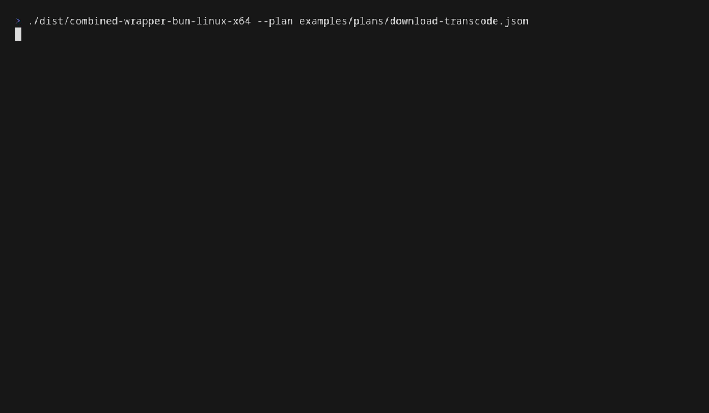
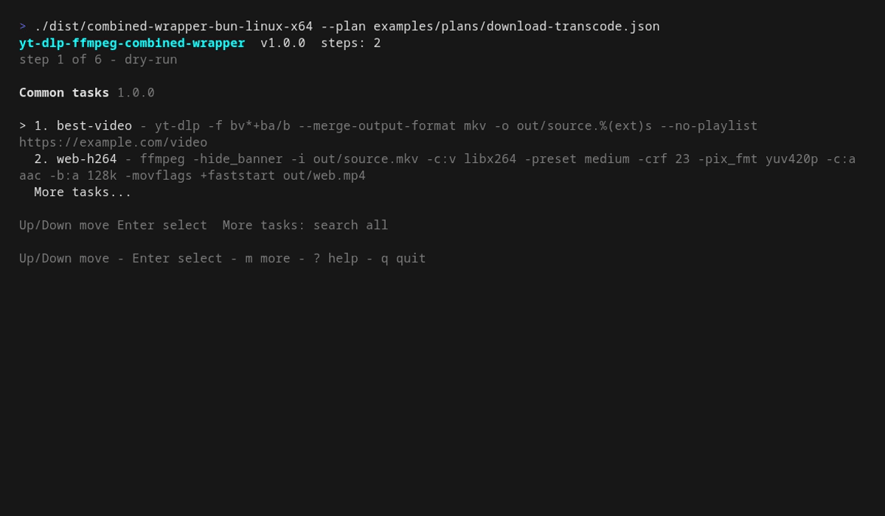

# Combined yt-dlp and ffmpeg wrapper

One tool for multi-step media jobs.
It plans and runs commands for `yt-dlp` and `ffmpeg`.
The tool uses a text user interface (TUI).
It runs in a terminal on Linux.
It does not upload your media.

## Demo



The picker shows every step in the loaded plan.



## Install

Download the Linux x64 or arm64 binary from the releases.
Or install the dependencies from source:

```sh
bun install --frozen-lockfile
```

Install `yt-dlp`, `ffmpeg`, and `ffprobe`.
The tool calls these binaries during a run.
Put each binary in your `PATH`.

## Quick start

Start the tool:

```sh
bun bin/combined-wrapper.ts --plan examples/plans/download-transcode.json
```

Pick a plan in the plan picker.
The first pass is a dry-run.
It validates the plan and shows every command.
It does not start a process.

Load a plan file directly:

```sh
bun bin/combined-wrapper.ts --plan examples/plans/download-transcode.json
```

Print the resolved commands and exit:

```sh
bun bin/combined-wrapper.ts --plan examples/plans/download-transcode.json --print
```

`--print` needs `--plan`.
It starts no process.

Read [docs/EXAMPLES.md](docs/EXAMPLES.md) for every sample plan.

Allow execution with a confirmation prompt:

```sh
bun bin/combined-wrapper.ts --plan examples/plans/download-transcode.json --run
```

Run without a prompt:

```sh
bun bin/combined-wrapper.ts --plan examples/plans/download-transcode.json --run --yes
```

Read [docs/PLAN-SCHEMA.md](docs/PLAN-SCHEMA.md) to write a plan.

## How it works

One plan holds one or more steps.
Each step uses `yt-dlp` or `ffmpeg`.
A step lists its arguments, outputs, and dependencies.

The tool checks the plan before it runs:

- Schema version and field types.
- Step ids and dependency cycles.
- Placeholder binding from `vars`.
- Rendered command text.
- Guard findings.

A dry-run stops after these checks.
`--print` stops there too and writes each rendered command.
`--run` executes the steps in dependency order.
A failed step stops the plan.
Each step can verify its outputs after it runs.
A later step can read an output from an earlier step.

See [docs/PLAN-SCHEMA.md](docs/PLAN-SCHEMA.md) for the full plan format.

## Keys

| Key       | Screen                  | Action                           |
| --------- | ----------------------- | -------------------------------- |
| `Up/Down` | Picker, More, Review    | Move the selection.              |
| `Enter`   | Picker, More            | Open the selected step.          |
| `Enter`   | Review                  | Continue to confirm.             |
| `Enter`   | Summary                 | Return to the picker.            |
| `m`       | Picker                  | Open the More list.              |
| `r`       | Review, Confirm         | Start the plan in `--run` mode.  |
| `a`       | Confirm                 | Confirm execution.               |
| `a`       | Progress                | Abort the run.                   |
| `y`       | Confirm                 | Confirm execution.               |
| `?`       | Any                     | Open or close help.              |
| `Esc`     | Any                     | Go back or close help.           |
| `q`       | Picker, Review, Confirm | Quit.                            |
| `Ctrl+C`  | Any                     | Abort the current step and exit. |

## Flags

| Flag            | Effect                                |
| --------------- | ------------------------------------- |
| `--plan <path>` | Read a plan JSON file.                |
| `--print`       | Print rendered commands and exit.     |
| `--run`         | Allow step execution. Off by default. |
| `--yes`         | Skip the confirmation prompt.         |
| `--force`       | Allow output overwrite.               |
| `--unsafe`      | Allow steps that need unsafe mode.    |

`--plan` reads a plan file.
`--print` needs `--plan`.
`--print` validates the plan and writes one command per step.
It starts no process.
`--run` is the only way to start a process.
`--yes` skips the prompt but not a guard.
`--force` and `--unsafe` never turn on by themselves.

## Safety

The tool does not execute a command by default.
Every plan starts as a dry-run.
`--run` enables execution.
`--print` writes the commands and starts no process.
`--yes` removes the confirmation prompt.
The overwrite guard blocks every declared output unless `--force` is set.
A step marked `unsafe` needs `--unsafe`.
The yt-dlp adapter marks `exec`, `exec-before-download`, and `postprocessor-args` as unsafe.
The ffmpeg adapter marks network inputs and script filters as unsafe.
The tool binds placeholders before execution.
An unbound placeholder blocks the step with `E_UNBOUND_VAR`.
The runner starts tool commands with argv arrays.
Verification commands run through `/bin/sh`.
Verification checks each output after its step.

## Limits

The tool runs on Linux only.
The v1 plan shell is `posix`.
Steps run one at a time in dependency order.
The tool does not retry a failed step.
The tool does not pick new flags after a failure.
Raw arguments have no correctness guarantee.
Download and transcode success is not guaranteed.
The overwrite guard cannot prove that a file is absent.
`yt-dlp`, `ffmpeg`, and `ffprobe` must be installed.

## Development

Repository layout:

- `bin/`: TUI entry point.
- `src/core/`: schema, DAG checks, binding, guards, and rendering.
- `src/contracts/`: tool adapter interface and example plan.
- `src/planners/`: yt-dlp and ffmpeg adapters.
- `src/runner/`: process control and output verification.
- `src/tui/`: screens, components, and key handling.
- `tests/`: unit, runner, CLI, and TUI tests.
- `scripts/`: checks and packaging.
- `docs/`: reference documentation.
- `examples/plans/`: sample plans.

Read [docs/EXAMPLES.md](docs/EXAMPLES.md) for sample plans and commands.

Run the full gate:

```sh
bun run ci
```

Run only the TUI tests:

```sh
bun run tui:test
```

Check this README:

```sh
bun run readme:check
```

Build the Linux binaries:

```sh
bash scripts/package-tui.sh
```

Regenerate the demo images:

```sh
bash scripts/capture-demo.sh
```

This needs `vhs`, `ttyd`, and `ffmpeg`.
The script writes `docs/images/demo.gif` and `docs/images/picker.png`.

Read [docs/PLAN-SCHEMA.md](docs/PLAN-SCHEMA.md) before you change the plan format.
